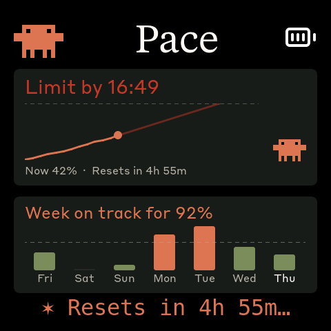
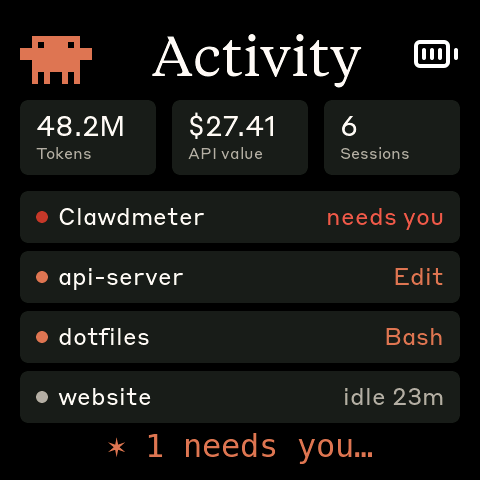
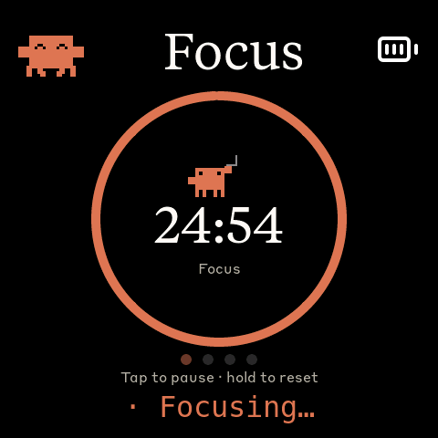
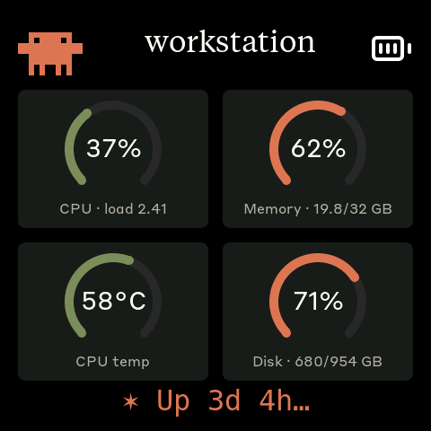
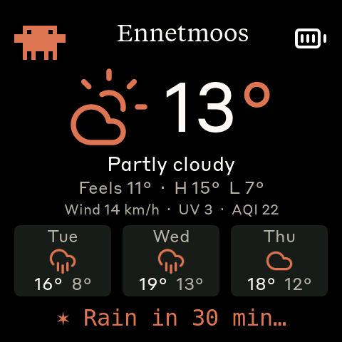
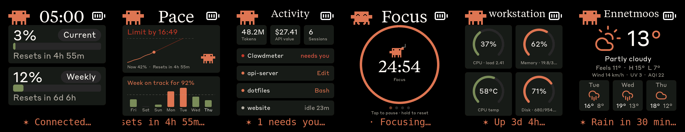
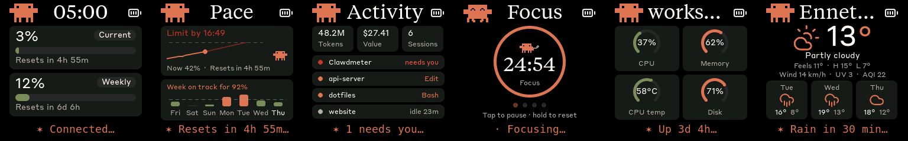

# Clawdmeter

> Also check out [Beam](https://github.com/notaharness/beam)! A CLI that lets you pair your machines using a passkey and [@Tailscale's tailcat](https://tailscale.com/blog/tailcat).


A small ESP32 dashboard I made for my desk to keep an eye on Claude Code usage.

It runs on a [Waveshare ESP32-S3-Touch-AMOLED-2.16](https://www.waveshare.com/esp32-s3-touch-amoled-2.16.htm?&aff_id=149786) as well as a few other alternative boards and pairs over Bluetooth, the splash screen plays pixel-art Clawd animations that get
busier when your usage rate climbs. The two side buttons step back and forth
between screens; held down, they send Space and Shift+Tab over BLE HID for
Claude Code's voice mode and mode-toggle shortcuts.


## Screens

The device boots into the splash. The screens, in button order: splash → Usage → Pace → Activity → Focus → System → Weather → Stocks → back to the splash. A short press on one side button goes to the previous screen and on the other to the next one. Screens fed by the daemon only show up once their data has arrived (see [Extra screens](#extra-screens)), and Focus is always there.

**Carousel:** every 30 seconds the device moves on to the next screen by itself. It skips Focus unless a session or break is running. Tap the panel to pause or resume it; the setting survives a reboot. Pressing a button restarts the 30 seconds.

**Touch** is the current screen's own action: on Focus a tap starts or pauses the timer and a long press resets it (or skips a break). On every other screen a tap pauses the carousel. While Clawd is waving for your attention, a tap dismisses him.

|              Splash               |              Usage              |               Pace                |               Activity                |
| :-------------------------------: | :-----------------------------: | :-------------------------------: | :-----------------------------------: |
|  |  |      |  |
|   Pixel-art Clawd animations      | Session and weekly utilization  | Where this window and week end up | Live Claude Code sessions, today's tokens |

|               Focus               |               System              |                 Weather                 |               Stocks                |
| :-------------------------------: | :-------------------------------: | :-------------------------------------: | :---------------------------------: |
|    |  |      |    |
| Pomodoro timer, on the device     | Your computer's CPU, memory, temperature, disk (optional) | Now + 3-day forecast (optional) | Your tickers, intraday (optional) |

The layouts adapt to the panel. The same screens on the 368×448 boards (AMOLED-1.8, S3 and C6):



and on the 240×240 LCD-1.54:



The status line at the bottom of each screen carries that screen's live fact (the reset countdown, who needs you, rain in the next hour…). While [status.claude.com](https://status.claude.com) reports an incident, it alternates with the incident name behind an amber (minor) or red (major) dot.

While the splash is up, the middle (PWR) button cycles animations. **Hold the power button for 3 seconds, then release, to put the device into pairing mode** — this clears the saved Bluetooth bond and re-advertises. The firmware also auto-rotates animations every 20 s within the current usage-rate group, so a long stretch on the splash isn't just one Clawd on loop.

## Hardware

Boards supported out of the box:

- [Waveshare ESP32-S3-Touch-AMOLED-2.16](https://www.waveshare.com/esp32-s3-touch-amoled-2.16.htm?&aff_id=149786)
- [Waveshare ESP32-C6-Touch-AMOLED-2.16](https://www.waveshare.com/esp32-c6-touch-amoled-2.16.htm?&aff_id=149786)
- [Waveshare ESP32-S3-Touch-AMOLED-1.8](https://www.waveshare.com/esp32-s3-touch-amoled-1.8.htm?&aff_id=149786)
- [Waveshare ESP32-C6-Touch-AMOLED-1.8](https://www.waveshare.com/esp32-c6-touch-amoled-1.8.htm?&aff_id=149786)
- [Waveshare ESP32-S3-Touch-AMOLED-2.06](https://www.waveshare.com/esp32-s3-touch-amoled-2.06.htm?&aff_id=149786)
- [Waveshare ESP32-S3-Touch-LCD-1.54](https://www.waveshare.com/esp32-s3-lcd-1.54.htm?sku=33869&aff_id=149786)
- [Waveshare ESP32-S3-Touch-LCD-4](https://www.waveshare.com/esp32-s3-touch-lcd-4.htm)

> Please check if a pull request exists for your alternative hardware port before opening a new one, providing QA feedback and testing on the same hardware is more valuable than duplicate pull requests.

**Porting to another board:** the firmware is a thin HAL with per-board folders under `firmware/src/boards/`. Drop in a new folder and a new PlatformIO env — `main.cpp`, `ui.cpp`, and `splash.cpp` never need to change. See [`docs/porting/adding-a-board.md`](docs/porting/adding-a-board.md) for the walk-through and [`docs/porting/hal-contract.md`](docs/porting/hal-contract.md) for the interfaces a port must implement.

## Prerequisites

- Linux (tested on Ubuntu), macOS, or Windows 10/11
- [PlatformIO CLI](https://docs.platformio.org/en/latest/core/installation/index.html)
- Linux: `curl`, `bluetoothctl`, `busctl`, `dbus-monitor` (BlueZ Bluetooth stack), `python3`, `setsid`, `stdbuf` (util-linux / coreutils), `systemctl` (systemd user services)
- macOS: `python3` (the installer sets up a venv with `bleak` and `httpx`)
- Windows: `python3` 3.11+ (the installer sets up a venv with `bleak`, `httpx`, and `pystray`)
- Claude Code with an active subscription

## macOS installation

The macOS host pieces — Python daemon, LaunchAgent, and flash helper — were ported by [Chris Davidson (@lorddavidson)](https://github.com/lorddavidson). Thanks Chris!

### Flash the firmware

```bash
./flash-mac.sh waveshare_amoled_216                       # ESP32-S3 2.16" (auto-detects /dev/cu.usbmodem*)
./flash-mac.sh waveshare_amoled_216_c6                    # ESP32-C6 2.16" variant
./flash-mac.sh waveshare_amoled_18  /dev/cu.usbmodem1101  # ESP32-S3 1.8" (or pass an explicit USB serial port)
```

The board env name is required. Run `./flash-mac.sh` with no args to see the available envs (scraped from `firmware/platformio.ini`).

### Pair the device

After flashing, open **System Settings → Bluetooth** and click _Connect_ next to "Clawdmeter". The daemon only ever connects to the peripheral this Mac is paired/connected to — it never scans for a nearby device — so once it's connected here the daemon picks it up on its next poll (~60 s).

### Install the daemon

The daemon reads your Claude OAuth token from the macOS Keychain (service `Claude Code-credentials`), polls usage every 60 s, and pushes it to the display over BLE.

```bash
./install-mac.sh
```

The installer creates a Python venv in `daemon/.venv/`, installs `bleak` and `httpx`, renders a LaunchAgent into `~/Library/LaunchAgents/com.user.claude-usage-daemon.plist`, and loads it. The first run is launched interactively so macOS prompts for Bluetooth permission.

Useful commands:

```bash
launchctl list | grep claude-usage                                          # check it's running
tail -F ~/Library/Logs/claude-usage-daemon.out.log                          # live logs
launchctl unload ~/Library/LaunchAgents/com.user.claude-usage-daemon.plist  # stop
launchctl load -w ~/Library/LaunchAgents/com.user.claude-usage-daemon.plist # start
```


## Linux installation

### Flash the firmware

```bash
./flash.sh waveshare_amoled_216                  # ESP32-S3 2.16" (defaults to /dev/ttyACM0)
./flash.sh waveshare_amoled_216_c6               # ESP32-C6 2.16" variant
./flash.sh waveshare_amoled_18  /dev/ttyACM1     # ESP32-S3 1.8" (or pass an explicit USB serial port)
```

The board env name is required. Run `./flash.sh` with no args to see the available envs (scraped from `firmware/platformio.ini`).

### Pair the device

After flashing, the device advertises as "Clawdmeter". Pair it once:

```bash
# Scan for the device
bluetoothctl scan le

# When "Clawdmeter" appears, pair and trust it
bluetoothctl pair F4:12:FA:C0:8F:E5    # use your device's MAC
bluetoothctl trust F4:12:FA:C0:8F:E5
```

To re-pair later, hold the power button for 3 seconds then release — the device clears its saved bond and re-advertises.

### Install the daemon

The daemon polls your Claude usage every 60 seconds and sends it to the display over BLE.

```bash
./install.sh
systemctl --user start claude-usage-daemon
```

Check status: `systemctl --user status claude-usage-daemon`

View logs: `journalctl --user -u claude-usage-daemon -f`

To change the poll interval, set `poll_interval = <seconds>` in `~/.config/claude-usage-monitor/config` (see `daemon/config.example`). The daemon picks it up without a restart. Polling slower than ~80s is fine: between polls the daemon replays the last payload every `heartbeat_interval` seconds (default 60) with the reset countdowns aged, so the firmware's 90s freshness window never lapses and no reflash is needed.

## Windows installation

Runs natively on Windows — no WSL required. A system-tray app polls your usage and pushes it over BLE, and starts automatically at login.

### Prerequisites

- **Native Windows** (not WSL).
- **Python 3.11+** from [python.org](https://www.python.org/downloads/) — check _"Add python.exe to PATH"_ during install.
- **Claude Code** installed, with `claude login` completed. The token is read from `%USERPROFILE%\.claude\.credentials.json` (falling back to `%LOCALAPPDATA%\Claude\` then `%APPDATA%\Claude\`).
- The repo on a **native Windows path** (e.g. `%USERPROFILE%\Clawdmeter`), **not** a `\\wsl$` share — the installer refuses a WSL path.

### Flash the firmware

```powershell
pio run -d firmware -e waveshare_amoled_216 -t upload --upload-port COM5   # use your device's COM port
```

Run `pio run -d firmware` with no env to see the available board envs.

### Pair the device

The device is a bonded BLE HID keyboard, so pair it once: **Settings → Bluetooth & devices → Add device → Bluetooth**, then select "Clawdmeter". Pairing is **required** — it enables the physical buttons and keeps a persistent connection (the device keeps showing your last-synced usage even after the daemon quits). To undo, use **Remove device** (this disables the buttons).

### Install the daemon (recommended)

From the repo root in PowerShell:

```powershell
powershell -ExecutionPolicy Bypass -File install-windows.ps1
```

This creates a venv, installs `bleak`/`httpx`/`pystray`/`Pillow` from the in-repo requirements (no internet downloads), registers a per-user login-autostart entry (`HKCU\…\Run`, no admin needed), and launches the tray app headlessly (no console window).

### Run manually instead (optional)

```powershell
python -m venv .venv
.venv\Scripts\Activate.ps1        # if blocked: Set-ExecutionPolicy -Scope CurrentUser RemoteSigned, then retry
pip install -r daemon\requirements-windows.txt
python daemon\claude_usage_daemon_windows.py        # runs in the foreground; Ctrl+C to stop
```

### Tray icon and menu

The icon's corner bubble shows state — **green** Connected, **amber** Scanning, **red** Error — and hovering shows the status (`Connected · last update HH:MM`). A notification fires once when it enters Error (e.g. an expired token). Right-click for the menu:

- **Status header** — live state + last sync time.
- **Start at login** — toggle autostart on/off.
- **Quit** — stops the daemon cleanly; leaves the Windows pairing intact (device keeps its last reading).

### Logs and troubleshooting

```powershell
Get-Content $env:LOCALAPPDATA\Clawdmeter\daemon.log -Tail 30        # view logs
reg delete "HKCU\Software\Microsoft\Windows\CurrentVersion\Run" /v Clawdmeter /f   # remove autostart
```

| Symptom                                | Fix                                                      |
| -------------------------------------- | -------------------------------------------------------- |
| `Device not found`                     | Power on the device; make sure it's in range and paired. |
| `token expired` toast / `API HTTP 401` | Re-run `claude login`, then restart the daemon.          |
| `Connection failed`                    | Toggle Windows Bluetooth off/on in Settings.             |
| `Warning: running under Linux/WSL`     | Run from a native PowerShell window, not a WSL shell.    |


## Attention alerts (optional)

When a Claude Code session is waiting on you (a permission prompt, a question, or the idle prompt after a reply), the corner Clawd walks off, a full-size Clawd walks on and waves and points, and the message scrolls on the status line. Add these hooks to `~/.claude/settings.json` (merge them into any hook arrays you already have) and point the path at your checkout. The script needs `jq`: recent macOS ships it as `/usr/bin/jq`, otherwise install it with `brew install jq` or `sudo apt install jq`.

```json
{
  "hooks": {
    "Notification": [
      { "matcher": "permission_prompt|idle_prompt|elicitation_dialog",
        "hooks": [{ "type": "command", "command": "/path/to/Clawdmeter/daemon/attention-hook.sh alert" }] }
    ],
    "PreToolUse": [
      { "matcher": "AskUserQuestion",
        "hooks": [{ "type": "command", "command": "/path/to/Clawdmeter/daemon/attention-hook.sh alert" }] }
    ],
    "UserPromptSubmit": [
      { "hooks": [{ "type": "command", "command": "/path/to/Clawdmeter/daemon/attention-hook.sh clear" }] }
    ],
    "PostToolUse": [
      { "matcher": "*",
        "hooks": [{ "type": "command", "command": "/path/to/Clawdmeter/daemon/attention-hook.sh clear" }] }
    ]
  }
}
```

Clawd walks back to his corner when you tap the screen, after 2 minutes, or when that session moves on (you answer, approve a tool, or send a prompt). He shows up about 5 seconds after Claude Code raises the notification, because the daemon checks once per tick. To hear a beep as well, set `beep = on` in `~/.config/claude-usage-monitor/config` (the installers ask). The macOS and Linux daemons handle these alerts; the Windows daemon doesn't yet.

## Extra screens

These screens are fed by the Linux daemon over the same BLE link. The board does no networking of its own and holds no keys. The macOS and Windows daemons don't send them yet. Each one drops out of the button order and the carousel when its data goes stale.

- **Pace** (on by default; `pace = off` turns it off). The top panel shows the current 5-hour window as a line from its start to now, plus a faint projection to the reset at your recent pace (the last 30 minutes, or the window's average early on). The headline says where you'll land, either "64% at reset" or "Limit by 15:40" when the limit comes first. Clawd stands next to the chart: he waves while you're comfortable, points when it's getting tight, and scuttles around when you're on course to hit the limit. In that last case the splash switches to racing-car and jumping animations, and the corner mascot fidgets. When the window refills, the splash celebrates with "jumping happy". The bottom panel shows the weekly % used on each of the last 7 days against an even-split share (dashed line), and the week's projection. The API only reports the current numbers, so the daemon keeps its own record of every poll in `~/.config/claude-usage-monitor/usage-history.jsonl` (8 days). The week fills in as the daemon runs. Pro/Max accounts only.
- **Activity** (on by default; `activity = off` turns it off). Shows your live Claude Code sessions (touched in the last hour): working with the tool it's running, needs you (red, from the [attention hooks](#attention-alerts-optional)), or idle and for how long. Above them are today's totals: tokens, their API-equivalent value at list prices, and sessions. Everything is read locally from the transcripts in each config dir's `projects/` folder, and only the summary goes to the device.
- **Focus** runs on the device only, with no daemon needed: 25 minutes of focus, then a 5-minute break (15 minutes after every fourth). A chime and the screen wake you at the end of each one. Clawd works at his laptop while you focus and rides his cloud on the break.
- **System** (off by default; set `system_stats = on`). Shows the computer the daemon runs on: CPU % and load, memory, CPU temperature in °C, and disk, refreshed every 30 seconds. The uptime goes on the status line.
- **Service status** (on by default; `service_status = off` turns it off). The daemon checks status.claude.com every 5 minutes; incidents appear on the status line as described above.

Weather and Stocks are off until you set them in `~/.config/claude-usage-monitor/config`. Changes are picked up within a tick, with no restart:

```ini
weather_location = Ennetmoos
stocks = AMD, NVDA=NVIDIA, PLTR=Palantir, R3NK.DE=Renk
```

- **Weather** comes from [Open-Meteo](https://open-meteo.com) (no account, no key) and refreshes every 15 minutes. It shows the current temperature and condition, feels-like and today's high/low, wind in km/h, the UV index, air quality (European AQI) and a three-day forecast. The status line says whether rain is coming in the next hour ("Rain in 30 min"), or otherwise gives the next sunrise or sunset. `weather_location` is looked up with Open-Meteo's geocoder; if it picks the wrong place, pin it with `weather_coords = 46.956, 8.339` (the location name is then shown as-is).
- **Stocks** come from Yahoo Finance's chart endpoint (unofficial, no key), refreshed every 5 minutes, up to 5 symbols. Use Yahoo's symbols — exchange suffixes like `.DE` (Xetra) or `.SW` (SIX) are accepted and dropped from the display. `SYMBOL=Label` overrides the company name shown under the ticker. Each row shows the price, the change since the previous close, and today's intraday line against a dashed previous-close baseline; mid-session the line only spans the part of the trading day that has happened. An orange dot next to the ticker means that market is open — without it the price is the last close — and the status line says whether any of your markets are open.

Weather and Stocks drop out after 3 hours without a refresh. Pace drops out after 15 minutes, and Activity and System after 5.

## How it works


1. The daemon reads your Claude Code OAuth token — from the macOS Keychain (service `Claude Code-credentials`) on macOS, or from `~/.claude/.credentials.json` on Linux (`%USERPROFILE%\.claude\.credentials.json` on Windows).
2. It makes a minimal API call to `api.anthropic.com/v1/messages` — one token of Haiku, basically free.
3. The usage numbers come straight out of the response headers (`anthropic-ratelimit-unified-5h-utilization` and friends).
4. The daemon connects to the ESP32 over BLE and writes a JSON payload to the GATT RX characteristic.
5. The firmware parses it and updates the LVGL dashboard.
6. The firmware also tracks the rate of change of session % over a 5-minute window and picks splash animations from the matching mood group.
7. The two side buttons are independent of all of this. A short press moves between screens. Held down, they send Space and Shift+Tab as BLE HID keyboard input to the paired host directly.

## Physical buttons

The board has three side buttons. Left and right are previous / next screen on a short press, and send HID keys when held for more than 0.4 s. The middle (PWR) button cycles splash animations (or the screen brightness on any other screen) and, held for 3 seconds, triggers pairing mode.

| Button           | GPIO         | Short press      | Hold                                                     |
| ---------------- | ------------ | ---------------- | -------------------------------------------------------- |
| **Left**         | GPIO 0       | Previous screen  | Send Space for as long as it's held (Claude Code voice-mode push-to-talk) |
| **Middle** (PWR) | AXP2101 PKEY | On splash: cycle animations. Elsewhere: cycle brightness | 3 s + release: pairing mode |
| **Right**        | GPIO 18      | Next screen      | Send Shift+Tab (Claude Code mode toggle)                 |

On the ESP32-C6 2.16, left/right are BOOT (GPIO 9) and KEY (GPIO 10). Boards with a single user button use it for next screen / Space. Space and Shift+Tab go out as standard BLE HID keyboard reports, so they trigger in whatever window has focus on the paired host — not just Claude Code. Push-to-talk starts 0.4 s after you press, which is how the device tells a hold from a press.

## BLE protocol

The device advertises a custom GATT service alongside the standard HID keyboard service:

|                            | UUID                                   |
| -------------------------- | -------------------------------------- |
| **Data Service**           | `4c41555a-4465-7669-6365-000000000001` |
| RX Characteristic (write)  | `4c41555a-4465-7669-6365-000000000002` |
| TX Characteristic (notify) | `4c41555a-4465-7669-6365-000000000003` |
| **HID Service**            | `00001812-0000-1000-8000-00805f9b34fb` |

JSON payload format (written to RX):

```json
{ "s": 45, "sr": 120, "w": 28, "wr": 7200, "st": "allowed", "ok": true }
```

Fields: `s` = session %, `sr` = session reset (minutes), `w` = weekly %, `wr` = weekly reset (minutes), `st` = status, `ok` = success flag.

Optional attention fields are only sent as part of a full payload, because the firmware treats every write as a complete usage update: `b` = beep once, `m` = attention message (ASCII), `x` = end the alert.

The optional extra screens use separate writes tagged with `k`, which a usage payload never carries (built by `daemon/extras.py`):

```json
{ "k": "wx", "loc": "Ennetmoos", "t": 12.8, "fl": 11, "c": 0, "d": 0, "hi": 15, "lo": 7,
  "f": [["Tue", 80, 16, 8], ["Wed", 80, 19, 13], ["Thu", 3, 18, 12]], "sun": "Sunrise 07:41" }
{ "k": "q", "i": 0, "n": 4, "sy": "AMD", "nm": "Advanced Micro", "cu": "USD", "p": 591.75,
  "pc": 608.1, "o": 1, "h": [51, 44, 27, 12], "b": 99, "fr": 62 }
```

```json
{ "k": "h", "sh": [2, 5, 9, 14, 23, 31, 42], "fr": 40, "pr": 123, "pz": 2, "eta": "16:49",
  "wd": [["Fri", 9], ["Sat", -1], ["Sun", 3], ["Mon", 18], ["Tue", 22], ["Wed", 12], ["Thu", 8]], "wp": 92 }
{ "k": "a", "ss": [["Clawdmeter", 2, "needs you", 0], ["api-server", 1, "Edit", 0]], "nl": 2,
  "tk": 48213004, "co": 2741, "ns": 6 }
{ "k": "sys", "hn": "workstation", "cpu": 37, "ld": "2.41", "nc": 16, "mem": 62, "mu": "19.8/32 GB",
  "tmp": 58, "dsk": 71, "du": "680/954 GB", "up": "3d 4h" }
{ "k": "ss", "i": "minor", "m": "Elevated errors on Claude Opus 5.5" }
```

Weather: `t` = temperature °C, `fl` = feels-like, `c` = [WMO weather code](https://open-meteo.com/en/docs), `d` = daytime, `hi`/`lo` = today's range, `f` = forecast days `[day, code, high, low]`, `sun` = next sun event for the status line (`"Sunset 18:45"`), `ws` = wind km/h, `uv` = UV index, `aq` = European AQI, `rn` = rain nowcast (`"Rain in 30 min"`). Quote: `i`/`n` = row index / row count, `sy` = symbol, `nm` = name, `cu` = currency, `p` = price, `pc` = previous close, `o` = market open, `h` = intraday closes scaled 0–99, `b` = previous close on that scale, `fr` = percent of the trading day `h` covers. Pace: `sh` = session % at the end of each 10-minute slot of the 5-hour window so far, `fr` = % of the window elapsed, `pr` = projected % at reset, `pz` = 0 comfortable / 1 tight / 2 limit before reset, `eta` = when the limit lands, `wd` = weekly % added per day (`-1` = no samples), `wp` = projected weekly % at its reset. Activity: `ss` = sessions `[project, state (0 idle / 1 working / 2 needs you), tool or label, minutes idle]`, `nl` = live sessions, `tk` = tokens today, `co` = API-equivalent cents today, `ns` = sessions today. System: `hn` = host, `cpu`/`mem`/`dsk` = %, `ld` = load, `tmp` = CPU °C (`-1` = no sensor), `mu`/`du` = used/total, `up` = uptime. Service status: `i` = Statuspage indicator, `m` = incident text. Strings are ASCII.

## Development


- **Desktop simulator** — iterate on the UI without hardware: an SDL2 window
  runs the full firmware loop with scenario playback (`pio run -d firmware -e
sim`, then `cd firmware && .pio/build/sim/program`). See
  [`SIM-USAGE.md`](SIM-USAGE.md) for controls, scenarios, and headless
  screenshots.
- **Splash animations** — Anthropic's official Clawd sprites, archived with
  provenance notes in [`research/clawd-official/`](research/clawd-official/);
  `node tools/convert_official_clawd.js` regenerates
  `firmware/src/splash_animations.h`. See [`tools/README.md`](tools/README.md).
- **Icons** — Lucide PNGs convert to LVGL C arrays with
  `tools/png_to_lvgl.js`. See [`tools/README.md`](tools/README.md).
- **Fonts** — the pre-compiled LVGL fonts and the LVGL-9 patching they need:
  [`docs/fonts.md`](docs/fonts.md).
- **Porting** — [`docs/porting/adding-a-board.md`](docs/porting/adding-a-board.md)
  and [`docs/porting/hal-contract.md`](docs/porting/hal-contract.md).

## Credits

- Pixel-art Clawd animations are Anthropic's official mascot art (claude.ai/code, Claude Code desktop), archived and converted by the tooling in `tools/` and `research/clawd-official/`.
- Lucide icon set ([lucide.dev](https://lucide.dev), MIT/ISC) for the bluetooth, battery and weather glyphs.
- Weather data from [Open-Meteo](https://open-meteo.com) (CC BY 4.0); stock quotes from Yahoo Finance (unofficial endpoint, personal use).
- Anthropic brand fonts (Tiempos Text, Styrene B) — see licensing warning below.

## Licensing gray area warning

The software in this repository uses and adheres to the Anthropic brand guidelines and uses the same proprietary fonts that Anthropic has a license for but this software uses without permission as well as using assets from Anthropic such as the copyrighted Clawd mascot so even though the code in this repo is non-proprietary I will not license it myself under a copyleft license since this repo includes proprietary fonts and copyrighted assets. Please be aware of this if you fork or copy the code from this repo. **You have been warned!**
