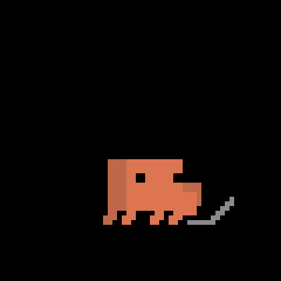
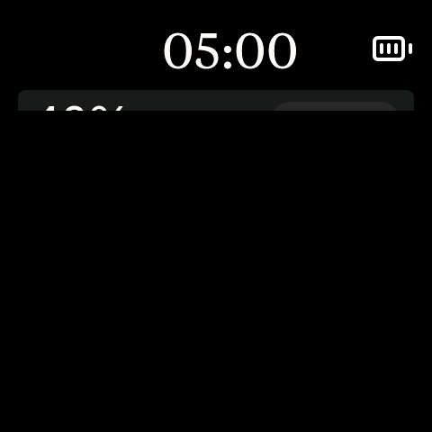

# Clawd's director: rooms, beats and the illusion of life

This is the firmware side of design system v0.4, sections 05–10: one Clawd who
lives on the meters and performs full size on a black stage that rises over
them. The behaviour depends on the situation (hook events, usage moving, a
session reset, attention), not on gestures. A tap on the stage means one
thing: show me the meters. On the meters themselves a tap is tapping the
aquarium: he comes out on the stage to see what you want (see "A tap on the
meters" below).

## Modules

| File | Role |
|---|---|
| `firmware/src/clawd_director.{h,cpp}` | Owns the rooms and runs the beats. It is the only module that decides what Clawd does next. |
| `firmware/src/clawd_policy.{h,cpp}` | Pure decision rules, unit-tested in `test/test_clawd_policy`: show gate and show group, screensaver gate, where attention returns to, how long a reaction waits for him, the corner seat's headroom, turn tracker, no-repeat picker, jitter, what a tap on the meters earns (the peek, how he sets off), how long the peek's stage stays up, and all tunables (`ClawdTuning`). |
| `firmware/src/mascot.{h,cpp}` | Clawd on the meters: the corner Clawd in his seat, plus the full-size sprite used for the lurk trip and the attention walk-on. Does in-room secondary action (idle acts, lurk trips) when the director allows it. |
| `firmware/src/stage.{h,cpp}` | The stage: a black curtain (a field in `THEME_BG`) that rises from the bottom bezel over the meters and drops back down (see "The stage"). |
| `firmware/src/performer.{h,cpp}` | Clawd performing on the stage: the official scenes at full size on a 60×60-cell grid centred on the panel, drawn above the curtain. He stands, walks on and off through either edge, or performs a scene. With PSRAM a screen-sized image; without it a cell sprite. |
| `firmware/src/cell_sprite.{h,cpp}` | The full-size Clawd without PSRAM: an LVGL object that draws his cells straight into LVGL's render, no image buffer (see "Boards without PSRAM"). |
| `firmware/src/field.{h,cpp}` | A flat-colour shape on an overlay that redraws only the strips that change colour (see "Redraw cost and frame rate"). The stage curtain is a field. |
| `firmware/src/perf.{h,cpp}` | The `perf` serial command: refresh count, timing and pixels sent for the last stage rise (`stage-rise`), stage drop (`stage-drop`) and performance (`perform`). |
| `firmware/src/clawd_anim.{h,cpp}` | Read-only view of the official animations. It is the only translation unit that includes `splash_animations.h` (about 400 KB of static data). |
| `firmware/src/ui.{h,cpp}` | Draws the meters only: cards, clock, status line, battery, the seat. Stale data dims the meters (see below); it never adds a second creature. It creates the stage and the performer last, in that order. |

`main.cpp` feeds the director per payload (`director_on_payload` after
`signals_ingest`, then `director_alert` / `director_alert_clear`), on buttons
(`director_button`), and once per loop (`director_tick`). A prompt or back-after-gap event (`e:"p"`
/ `e:"b"`) also calls `idle_note_activity()` first, so a dimmed or dark panel
fades back in before he notices you; an alert already did. A Stop or tool
activity does not wake the panel: Claude working alone isn't you. Taps come straight
from LVGL: an indev `LV_EVENT_PRESSED` callback, so the reaction starts on the
next frame, not on release.

## Rooms

- **Meters**: home, the default, and where every path ends. The corner Clawd
  sits in his seat (3 px cells on a 480 panel). The lurk trip and the big
  attention Clawd (12 px cells) walk over the meters too.
- **Stage**: the black curtain over the meters (see "The stage"). The
  performer, full size (8 px cells on a 480 panel), appears only here: the
  screensaver, the peek and earned shows.

`director_room()` returns `ROOM_STAGE` while any of the stage is on screen,
else `ROOM_METERS`.

**Performing on the stage.** The curtain covers everything below it (the
meters, a page's layer, the battery, the corner seat), so he performs on
black, as on v1's splash, with nothing behind him redrawing. His 60×60-cell
grid is centred on the panel (`performer_init(scr, -1)`), and he's never
dimmed or see-through. The performer's image is hidden whenever he's off
screen, so nothing ever blends a screen-sized transparent image, and each
frame invalidates only the cells that changed.



**Under a page.** The pages (Pace, Activity, Focus, System, Weather, Stocks:
`firmware/src/pages.h`) take
the meters' cards, title and status line; the corner Clawd's seat stays.
`director_set_covered(true)` ends whatever was staged at once (the page
change is the cut: the stage hidden with `stage_hide_now()`, performer off
stage, Clawd seated) and holds
him there, still: no idle acts or lurk trips, no show, screensaver or peek,
and a tap is the page's. The QA beats refuse to start. An alert never runs
covered: `main.cpp` closes the page first. `test/test_director` fuzzes page
changes along with everything else and fails if anything but the seated
corner Clawd is up while covered.

**Carousel.** With the carousel on (a tap on a page toggles it), the pages
step every 30 s, the meters included. It only leaves the meters when
`director_settled()`: he's home in his seat, not on a lurk trip, with no
show, stage or alert up. So a page never cuts a beat short; it waits for the
next quiet moment.

**Pace.** The Pace page's write carries a zone; zone 2 (at this rate the
limit lands before the reset) lifts the mood group to Heavy like hook
activity does (`usage_rate_set_pace`, 20-minute TTL), so his corner acts,
the show's pick and the stage's scenes follow it. Nothing else changes: the
fresh-window joy already celebrates a reset.

Continuity rules, as the code enforces them:

- There is only ever one Clawd. The corner sprite, the full-size sprite and
  the performer are never on screen together; each beat waits for one to be
  off screen (`mascot_away()`, `performer_visible()`) before the next
  appears. The stage is not a Clawd, but it has rules of its own: the
  performer is visible only while the stage is, and the corner and big Clawd
  are never on screen while it is. `test/test_director` runs the real
  director against timed stand-ins for these actors and checks all of this
  (`check_one_clawd`) on every tick through a seeded fuzz of everything that
  can happen.
- He enters and leaves through an edge. Walks use the official walking gait
  with foot-locked translation (`clawd_gait_cells`) and mirror when heading
  left. When the corner leaves, he takes the nearest edge; the performer
  comes on and goes off through the left edge, where the corner Clawd left
  and comes back.
- The screen never cuts. The stage rises over the meters only once he's
  gone, and drops back off them only once he's walked off it.
- The normal status line rotates Claude Code's whimsical thinking verbs as
  the all-is-well indicator. This is the owner's chosen behavior, not an
  activity report. Keep the spinner and ellipsis. Disconnected is "Waiting";
  minimal mode uses fixed status text instead of rotating verbs.
- Stale data keeps the one-Clawd rule. When the link is up but no fresh usage
  has landed for `DATA_FRESH_MS` (90 s), or the daemon sent `{"ok":false}`,
  the meters stay where they are at 40 % opacity (LVGL `opa`, which scales the
  draws and needs no layer buffer, so it's free on the C6) and the status line
  alternates "Stale…" (or "No data…" before the first payload) with
  "Listening…". The corner Clawd stays in his seat. Shows and the screensaver
  need live meters, so they wait.

## Beats

The director runs one beat at a time. A beat is a list of steps, and each step
issues commands. The next step starts once every actor has settled (stage
not moving, performer and mascot not busy) and any explicit pause has
passed. Beat changes always print; every step prints too after
`director_set_trace(true)` (the sim turns it on with `SIM_TRACE=1`).

| Beat | Trigger | Steps |
|---|---|---|
| `home` | default | Corner autonomy on: jittered idle gaps (±40 % of 10 / 7 / 5 / 3.5 s by mood), mood-picked acts, never the same act twice running, and lurk trips (PSRAM). Also checks the gates below. |
| `corner` | notice, wave, joy, or after a transition | Waits for the commanded corner act or walk to finish, then `home`. |
| `show` | `a == 3` held for 5 min; at most one per 15 min; hooks seen; meters live | Points at the bar (or, if he's out on a lurk trip, heads straight out) and walks off left at 1.5×. Once he's gone the stage rises; he walks on full size at 1.5×, plays one scene from the show group (loop held 16 s, so about 20 s), waves and walks off left; the stage drops and the corner Clawd walks in from the left to his seat. Without the performer (no PSRAM): points, then dances twice (jumps for joy twice when usage is Heavy) and waves, all in his seat. |
| `screensaver` | 10 min with no engagement; needs hooks seen or a window that hasn't started; meters live | Walks off through the nearest edge (a lurk trip finishes its peek first), the stage rises, and he strolls on (1×). He performs scene after scene from his current mood group (`usage_rate_group()`, so the pace lift and hook activity count), never the same scene twice running, each loop held 16 s, standing in the idle pose for 4–8 s (jittered) between scenes; walker scenes do their round trip. Without the performer the black stage rests empty. The meters going stale or the link dropping sends it back to the meters. |
| `stage-home` | "show me the meters" from the stage: a tap, prompt, button or usage moving during the screensaver; a tap during the peek or the end of its 5 min; a tap during a show; liveliness turning the beat off; attention | If he's on the stage the scene releases to the idle pose on the spot, holds 200 ms, and he runs off left, ramping from 1.5× to 3× over 400 ms. Once he's gone the stage drops. Then (`arrive_meters()`): attention if an alert is waiting, the screensaver again if an alert ended with nobody around, else the corner walks home at 1.5×. |
| `peek` | any tap on the meters (`home` or `corner`), live or stale (below) | Seated: a startled hop (`jumping` from its crouch, 2.5×), then he ducks out through the nearest edge at 5×; already moving or out: straight out at 5×. The stage rises, he walks on (1.5×), waves hello, then performs scene after scene as on the screensaver, for 5 min or until a tap. Both end through `stage-home`. Without the performer a tap is just the corner's hop (no peek). (below: what else happens while it's up) |
| `attention` | `m` (alert) in a payload | The corner walks off at 2×, the big Clawd (12 px cells) walks on at 2× over the meters, then waves and points alternately (no PSRAM: he waves and points in his seat). The alert lasts until a tap, `x` (clear) or 2 min; his animation lasts the **attention animation** time (below), 2 min by default, after which the big one walks off left and the corner Clawd sits in his seat while the alert stays up. Off: no animation, he sits in his seat. A new alert animates again. The big Clawd needs the meters, so an alert during anything on the stage goes through `stage-home` first, and then returns to where it left off (below). |

A "show me the meters" that lands before the stage is up (he's still
pointing or walking off) needs no `stage-home`: he turns around and walks
back to his seat at 1.5×.

**Which scene a show plays.** The trigger (activity 3) lifts the live mood
group to Heavy, so the show reads the usage-only base group instead, floored
at Active (`clawd_show_group`): idle-to-active usage plays the Active set
(laptop, dancing, skateboard, soccer), real burn plays the Heavy set (racing
car, cloud, sailing, jumping happy). The stage's scene loop (screensaver,
peek) reads the live group as it is. Neither repeats the previous scene: the
show and the scene loop share one no-repeat memory
(`performer_perform_group`).

**Where attention returns to** (`attention_resumes_screensaver`):

- It interrupted the **screensaver** and nobody showed up (the alert timed out,
  or was cleared with no tap, button, prompt or tool activity since it
  started): the big Clawd walks off, the corner Clawd stays out of sight, and
  the stage rises again with him strolling back on. The screensaver carries
  on as if never interrupted.
  A refreshed alert (a second `m` while one is up) keeps any sign of you seen
  so far, and a new alert that lands while the last one is still leaving for
  the screensaver inherits that origin.
- It interrupted a **show**: the show ends gracefully home. It was a 20 s
  treat; replaying it after an alert of up to 2 minutes would be stale, and the
  show gate already counted it, so the next one is earned as usual.
- A **tap** dismissing it, or any sign of you during it, always ends on the
  meters ("show me the meters"), with the corner Clawd walking home.

Small reactions on the meters, from `home` or `corner`:

- **Noticing**: `e:"p"` or `e:"b"`. He points once (anticipation). From the
  screensaver the same event wakes him (`stage-home`).
- **Long-turn wave**: `e:"s"` when the turn (first prompt to stop) ran at
  least 2 min. He waves once.
- **If he's out** (a lurk trip, or walking back from one): the reaction isn't
  dropped. He cuts the trip short (the rest of the peek plays at 3×), hurries
  back to his seat at 2.5× (or turns around if he was still heading out), and
  then reacts. The reaction waits up to 15 s (`react_pending_ms`) for him. A
  reaction arriving while a commanded act plays queues behind it.
- **Fresh window**: `session_reset` from signals (real samples only, so never
  on a replay). He jumps happy twice, in the same loop iteration as the chime.
  If he's out on a trip he hurries back for it; if he's in another room it
  waits up to 5 min for him to sit down. It outranks the wave.

### A tap on the meters (the aquarium)

While the director is on the meters (`home`, or `corner`: a commanded act, a
walk home), every tap draws his attention and he comes out on the stage to
see what you want (`clawd_tap_react`). There's no cooldown and no lesser
reaction: the stage is what a tap on the glass gets.

- **Seated** (or in an idle act of his own): a startled hop on the next frame
  (`jumping` from frame 1, its crouch, not the idle frame every act opens
  with) at 2.5×, then he ducks out through the nearest edge at 5×. His seat
  is a few steps from the left edge, so the stage starts rising soon after
  the tap. One Clawd: he leaves before the stage rises (the "enter and leave
  through an edge" rule), since the curtain may never cover the corner
  sprite.
- **Already up and about** (a commanded act, walking home, a lurk trip): he
  heads straight out at 5×. A lurk trip finishes its peek at 5× and he stays
  out; a walk out for a lurk becomes a plain exit. A queued corner reaction is
  dropped.
- **Stale or pairing meters** don't stop it: the stage covers the hint for as
  long as it's up, and the hint is back when it drops.
- **A tap during the hop or the exit** is absorbed (nothing queues).
- **A tap while the peek's stage is up** (or still rising): `stage-home`: he
  runs off, the stage drops, and he walks back to his seat. A tap while he's
  walking back brings him straight back out.
- Where you tap is logged (`tap at x …`) but doesn't change the peek.

**While the peek's stage is up** he stays for `peek_curious_ms` (5 min,
counted from when the stage starts to rise; `peek_hold`):

- He waves hello, then performs scene after scene from his mood group as on
  the screensaver, standing in the idle pose for 4–8 s between them.
- After 5 min he goes home on his own (`peek over (curiosity)` in the log):
  `stage-home`, the run-off, the drop, and he walks back to his seat.
- Prompts, stops, usage moving, buttons and PWR don't end it, and the usual
  corner reactions (pointing, the long-turn wave) are skipped: he's on the
  stage, not in his seat. They still count as engagement. A fresh-window joy
  keeps its usual 5 min wait for him to sit down; a show that comes due waits
  for him to be home.
- **The meters going stale or the link dropping** doesn't end it either
  (you asked to see him). The stale hint shows once the stage is gone.
- **The screensaver can't start under it.** The tap that raised it is
  engagement, and the peek (5 min) runs out well before the screensaver's
  10 quiet minutes, so he always goes home first; the screensaver can
  come 5 min later, from the meters, as usual.
- **Attention** interrupts it like anything else (`stage-home`, then the big
  Clawd). When the alert ends it's the meters, not the stage: the peek
  started from the meters (`ATTN_FROM_HOME`), and putting him back on stage
  after you've been fetched would be a non sequitur.
- The 30-minute idle fade still applies (in practice the peek is long over
  by then), and a waking tap only wakes the panel.

Unchanged: a tap during attention dismisses it, and a tap during a show or
the screensaver still means "show me the meters". In minimal mode the tap
does nothing (he stays on the still frame). On the C6 it all works: the stage
is a field, the performer a cell sprite, and the corner sprite has its
internal-RAM buffer. A tap
that wakes a dark panel is swallowed by `idle_consume_wake_press` (it never
reaches LVGL), so the waking tap only wakes the panel. Every tap counts as
presence: the press edge resets the idle timer, and `director_tap` counts it
as engagement for the screensaver clock.

**The seat leaves headroom for the jump.** Jumping happy rises 12 cells above
the idle pose (30 cells tall). `ui.cpp` lowers the seat's feet line just enough
for it to clear the top edge by 2 px without touching the first panel
(`corner_seat_feet`): on 480×480 the feet sit at y 92, and the 368×448
compact layout starts its panels at y 96 to make room. A 240 px panel has no
such room (the seat would land in the first panel), so there `mascot_act`
swaps any act taller than the headroom for dancing (17 cells) rather than clip
him.

**Engagement** resets the screensaver clock. Engagement is any fired hook
event, any activity level above 0 (tool calls are hook events too), a tap, a
button, an alert, or a real sample where session % went up. Usage going up
also wakes the screensaver, which covers the slow-clock-only case.

## Animation principles and implementation

| Principle | Implementation |
|---|---|
| Anticipation | Pointing before a show and on a prompt, the startled hop before the peek, a beat before the run-off, a turn toward the edge (walking intro frames) before every exit. |
| Follow-through, overlapping action | The run-off: the scene releases to the idle pose and holds a beat, then the walk-off picks up speed. Scenes always end on the idle pose, so the next thing starts from the same spot. |
| Timing | Taps act on `LV_EVENT_PRESSED`. `performer_release()` snaps to the idle pose in the same frame. |
| Secondary action | `clawd_jitter` for idle gaps, `clawd_rng_range` for the jittered rests between stage scenes, `clawd_pick_no_repeat` for acts and scenes. |
| Staging | The stage clears everything else away while he performs: black, nothing behind him redrawing, him centred, and one actor at a time. |
| Slow in, slow out | Ease-out as the stage rises, ease-in as it drops, the run-off's speed ramp. Walks begin on intro frames and end on the outro. |
| Exaggeration | Wave for a long turn, show for a busy stretch, jumping happy for a reset, the big Clawd for attention. |
| Appeal | He comes out on the stage for the screensaver and when you tap the meters: you drew his attention, so he comes out to see what you want. |

## The stage

The stage (`stage.{h,cpp}`) is a black curtain (`THEME_BG`) the size of the
panel. `ui.cpp` creates it on the meters screen after the meters, the pages
layer, the battery and the corner Clawd, and before the performer, so it
covers all of them and he draws on top. It's a field (`field.{h,cpp}`), so it
costs only the rows it gains or loses (see "Redraw cost and frame rate").

- **The rise** (`stage_rise()`): up from behind the bottom bezel in 450 ms,
  ease-out. Once it's fully up the meters are hidden underneath with
  invalidation paused (`field_quietly`), so nothing redraws behind the black.
- **The drop** (`stage_drop()`): 380 ms, ease-in. Its top edge falls, so it
  uncovers the meters from the top. They're shown again (quietly) as the
  drop starts.
- **No animation** (`stage_hide_now()`): a page opening, a minimal-mode
  switch.

The motion is vertical only, with a flat top edge, and a pure function of
elapsed time, so durations stay fixed and never depend on frame rate. The
director waits on `stage_moving()` like any other actor.

**The performer's run-off** (`stage-home`) gets follow-through through
timing only, never new frames: the scene releases to the idle pose and holds
a beat (anticipation), then the walk-off ramps from 1.5× to 3× over its first
400 ms (ease-in) instead of starting at full speed.



## Round panels

With `BoardCaps.round_panel` the glass is the circle inscribed in the
panel, so Clawd walks on and off along it. `panel_row_span()` in
`splash_geometry.h` gives the visible span of a row (the whole width on a
rectangular panel, the circle's chord on a round one) and every entrance
uses it at the row he walks on: the corner Clawd leaving and coming back
(`mascot.cpp`: `off_left_x` / `off_right_x`), the full-size attention walk-on
and walk-off, the lurk peek, and the performer's walks (`performer.cpp`: the
grid cells on the glass at his floor row). None of them spends time walking
where there is no glass, and nobody starts at the bounding box's edge.
Rectangular panels are unchanged. Unit-tested in `test/test_splash_geometry`.

## Alert dismissal and expiry

A tap or the device's 2-minute attention timeout ends the local alert and
sends `{"dismiss":true}` on BLE TX (`…-0003`). The app clears the alert it
sent, including its tray state, without echoing a clear back. A host `x`
clear ends the device alert without a dismissal notification.

On a board without a touchscreen (`BoardCaps.has_touch` false) the main
button is the dismiss gesture: BOOT, or the PWR key when it is the board's
only button (`button_count` 0). `director_button(true)` ends an active alert
the same way a tap does and reports the press as consumed, so `main.cpp`
doesn't send push to talk (or cycle brightness) for it. With no alert up
the button keeps its normal role. A board with neither touch nor a button
lets the alert time out. `SIM_NO_TOUCH=1` plays such a board in the
simulator.

The app also expires uncleared alerts after 2 minutes; Hooks test alerts
expire after 30 seconds. If the alert was sent, app expiry queues a clear
for the device. These app limits are separate from the device's 2-minute
attention timer (`SIM_FAST` compresses that device timer to 20 seconds).

## Minimal mode

When `BoardCaps.minimal_ui` is true, `minimal_mode()` returns true. This is
a board capability, with no NVS override, desktop setting, or serial toggle.
`SIM_MINIMAL=1` sets the simulator capability at startup. In this mode:

- No stage or performances, lurk trip, idle acts, noticing, wave or joy.
- The corner Clawd stays on the official still frame (walking frame 0).
- Attention: a held pointing frame (pointing frame 16) in the seat, and the
  message in the status line, truncated rather than scrolled. A tap dismisses
  it, as do `x` and the 2 min timeout.
- The status line shows a fixed glyph and one word ("Connected", "No data",
  "Waiting") and redraws only when the state changes.

## Boards without PSRAM (C6)

- Corner Clawd: animated. Its buffer, sized for the largest corner act
  (jumping happy, 28×30 cells × 3 px, about 23 KB), falls back to internal RAM.
- Stage: a field, the same as on S3. It draws its rectangle in LVGL's
  render and needs no buffer, so it's cheap everywhere.
- Full-size Clawd (the performer, the attention walk-on and the lurk trip):
  the same beats as on S3. The image buffers (about 690 KB and 250 KB) don't
  fit, so a cell sprite (`firmware/src/cell_sprite.{h,cpp}`) stands in: an
  LVGL object whose `LV_EVENT_DRAW_MAIN` paints the frame's cells as
  rectangles, one per run of same-coloured cells in a row, only for the rows
  and columns inside the area being redrawn. Empty cells draw nothing, so
  whatever is behind him (the stage, or the meters under the walk-on) shows
  through exactly as with the image. It needs a few dozen bytes
  and leaves the LVGL pool's peak where it was (34 KB in the sim). The
  invalidation is shared with the image path, so a frame costs what moved.
  In the sim (`SIM_NO_PSRAM=1`) the walk-on, walk-off and lurk frames match
  the image path pixel for pixel. Frame time on the C6 is the real check:
  the `perf` serial command reports it.
- The seat fallbacks below (a show as corner acts, attention as a wave and
  point in his seat, no lurk trip) remain for a board where even the cell
  sprite can't be created. There, the screensaver's stage rests empty and a
  tap is just the corner's hop.

## Buttons

- BOOT (Space) and SECONDARY (Shift+Tab): unchanged. They also count as
  engagement and wake the screensaver.
- PWR short press: cycles brightness and counts as engagement (waking the
  screensaver). Hold to pair is unchanged.
- During a show or the peek a button is engagement only: it doesn't end
  them (a tap does).
- Shows are earned rather than opened by a button or a tap.

## Tunables

`ClawdTuning` in `clawd_policy.h` holds all the timings (the numbers here
are Some-nonsense, liveliness 3; see "Liveliness" below): show after 5 min,
cooldown 15 min, show scene loop 16 s, quiet 10 min, rest between stage
scenes 4–8 s (`stage_rest_min_ms` / `stage_rest_max_ms`, jittered), stage
scene loop 16 s (`stage_scene_ms`), alert timeout 2 min, long turn 2 min,
joy wait 5 min, reaction wait 15 s, peek 5 min (`peek_curious_ms`).
`clawd_tuning_fast()` compresses them for the sim (`SIM_FAST=1`; the stage
rests become 2–3 s and its scene loops 5 s, and the peek 12 s, under the
15 s quiet time as in the defaults).

## Liveliness

The app's **Animation silliness** slider (config `liveliness`, payload `lv`, 1–5,
default 3) sets how lively Clawd is. The device stores the last value in
NVS (`clawd_prefs.cpp`, key `lively`) so it applies from boot. One pure
function, `clawd_tuning_scaled()`, turns the base tuning (the defaults, or
`SIM_FAST`'s) into the effective one; the director, the corner and the
status line read nothing else, and `director_set_liveliness()` applies a
change at once (a show or screensaver the new level rules out goes home).

| Level | What changes |
|---|---|
| 1 No-nonsense | No shows, screensaver, idle acts or lurk trips, and no reactions (noticing, long-turn wave, fresh-window joy). The status line's verb changes once a minute and the spinner holds still, so with no taps or alerts only the clock and that word redraw. A tap still gets the peek, an alert still gets the attention walk-on. |
| 2 | Rate-like timings ÷ 0.6: show after ~8.3 min, cooldown 25 min, rests between stage scenes ~6.7–13.3 s, corner still time ×1.67, wave after a 3.3-min turn. |
| 3 Some-nonsense | The base timings above. |
| 4 | ÷ 1.8: show after ~2.8 min, cooldown ~8.3 min, stage rests ~2.2–4.4 s, still time ×0.56, wave after ~67 s. |
| 5 All-nonsense | ÷ 3: show after 100 s of activity **2** or more (not just 3), cooldown 5 min, stage rests ~1.3–2.7 s, still time ×0.33 (never under 1.5 s), wave after a 40-s turn. |

The quiet time before the screensaver (10 min) doesn't scale: it measures
you being away, not him. Nor do the scene loops or the peek's 5 min. Levels
2 and 4 sit between their neighbours on a
log scale (0.6 / 1 / 1.8 / 3). Native tests: `test_clawd_policy` (the
scaling), `test_director` (No-nonsense sits still through activity, prompts,
stops, usage and a reset but still peeks on a tap; turning it down mid-show
ends the show; the one-Clawd fuzz at every level). In the sim:
`SIM_CMDS="300:liveliness 1"`, or `"lv":1` in a scenario line.

## Attention animation

The app's **Attention animation** (config `attention_anim` = `off`, `10s`,
`30s` or `2m`; payload `aa` in seconds, 0 / 10 / 30 / 120) sets how long
Clawd points and waves for an alert. It's stored in NVS (`clawd_prefs.cpp`,
key `attn_anim`) and liveliness doesn't touch it. Only his animation stops:
the message, the dismissing tap, `x`, the 2-minute alert timeout and the
`{"dismiss":true}` notify are unchanged. When the time is up the big Clawd
walks off and the corner Clawd walks home to his seat (no PSRAM: the seat's
wave stops); he sits still there until the alert ends. `clawd_attn_anim_ms()`
maps the setting onto the tuning's alert timeout (2 min = the whole alert),
so under `SIM_FAST` 30 s is 5 s of the 20 s alert. Native tests: Off and a
10 s setting, with and without the full-size sprite, and the one-Clawd fuzz
at Off / 10 s / 30 s (`test_director`). In the sim:
`SIM_CMDS="300:attention_anim 0"`, or `"aa":0` in a scenario line.

## QA

- Native: `pio test -d firmware -e native -f test_clawd_policy` (the rules)
  and `-f test_director` (the director against timed stand-ins for its
  actors: one Clawd on screen and the stage rules at every tick of a seeded
  fuzz, every beat reached, and nothing left hanging once the input stops;
  `test_screensaver_performs_on_the_stage`, `test_peek_is_the_stage` and
  `test_show_is_on_the_stage` walk each stage beat through).
- Sim: `SIM_FAST=1 SIM_SCENARIO=sim/director.jsonl`, plus `SIM_SHOTS` /
  `SIM_TAPS` for headless capture (see `docs/simulator.md`) and `SIM_TRACE=1` for
  the per-step trace. The interruptions (lurk cut short, attention resuming
  the screensaver, PWR on the screensaver) have their own scenario, driven by
  `SIM_CMDS` (scripted serial commands; `pwr`, `prompt`, `stop` and `alert`
  stand for the PWR button, the `e` / `t` keys and the `m` key):

  ```bash
  SIM_FAST=1 SIM_SCENARIO=sim/director-resume.jsonl \
  SIM_CMDS="2500:clawd lurk;5200:prompt;34000:alert;67500:pwr;80000:prompt" \
  .pio/build/sim/program
  ```

  A reference set of captures is in `screenshots/director/`, all simulator
  output at 480×480 unless named otherwise: 01–25 the main walkthrough (05–09
  a show on the stage: the stage rises, he walks on, the scene, the wave, he
  walks off, the stage drops, the corner walks home; 10–12 a tap during the
  show: released to idle, the run-off, the corner home; 14–18 the
  screensaver: he gets up, the stage rises, a scene, then the wake: the
  run-off and the hurry home), 26 stale data, 27–29 a lurk cut short, 30
  attention handing back to the screensaver, 33–34 the jump at 368×448 and
  its 240×240 fallback, 35-peek-* a tap on the meters (crouch, hop, ducks
  out, the stage rises, he walks on, waves, performs, a tap runs him off,
  back in his seat), 37–38 a show on the stage at 368×448 and 240×240, 39
  No-nonsense mid-walkthrough (he sits still), 40–42 the attention animation
  at 30 s (waving, then back in his seat with the alert still up) and Off.

  The tap captures come from a single live payload (any one-line scenario
  with a long `hold_ms`) with scripted taps:

  ```bash
  SIM_FAST=1 SIM_TRACE=1 SIM_SCENARIO=<one live payload> \
  SIM_TAPS="3000@420,300;16000@240,300;19000@60,300" \
  .pio/build/sim/program
  ```

  3 s: the peek: he hops, ducks out, the stage rises, he walks on, waves and
  performs until the tap at 16 s runs him off and drops the stage. 19 s:
  he's still walking back to his seat, and the next tap sends him straight
  back out (no hop, no cooldown); left alone, he goes home on his own after `SIM_FAST`'s 12 s
  peek (`peek over (curiosity)` in the log). Add `SIM_CMDS="2000:link"` to
  drop the BLE link first: the tap on the pairing hint gets the peek just the
  same. For the stale (dimmed) meters, let one payload go 90 s without a
  refresh and tap after that.
- Hardware: send `clawd show`, `clawd screensaver`, `clawd attention`,
  `clawd joy`, `clawd lurk`, `clawd peek [x]` (the peek now, as a tap at x)
  or `clawd home` on the serial console, then `screenshot`
  (`.claude/skills/capturing-device-screenshots/scripts/screenshot.py`). This replaces swapping the boot screen in `main.cpp`.
  `clawd show`, `clawd screensaver` and `clawd peek` go to the stage.
  The device boots to the meters. `perf` prints the redraw cost of the last
  stage rise, stage drop and performance (below).

## Redraw cost and frame rate

The stage is a big flat rectangle that moves. As an ordinary LVGL object
every move would invalidate its whole old and new area, so each frame of the
rise would be a near full-screen render plus a full panel flush (about
460 KB over QSPI on the 2.16), and LVGL's default 33 ms refresh would cap it
at 30 fps.

- **Fields** (`field.{h,cpp}`): the curtain is a full-screen object that
  never moves and draws its rectangle in `LV_EVENT_DRAW_MAIN`. Moving the
  rectangle invalidates only old XOR new: the rows its top edge just moved
  through. At rest a field is `LV_OBJ_FLAG_HIDDEN` with an empty rectangle.
  Showing, hiding or restacking a full-screen object would invalidate the
  whole screen even when it draws nothing, so those run with
  `lv_display_enable_invalidation(false)` around them (`field_quietly`). So
  does hiding the meters under the full curtain and showing them again as it
  drops: no pixel changes either time.
- **The performer** repaints only the cells that changed (into the image,
  or nothing at all for the cell sprite) and invalidates their bounding box,
  instead of the whole screen-sized image every frame, and is hidden (quietly, the same way) whenever he's off
  screen. A show in the sim averaged about 18 k px/frame (7.7 % of the
  panel) when he performed over the meters; on the stage it hasn't been
  re-measured.
- **Refresh period 16 ms** (`-DLV_DEF_REFR_PERIOD=16` in every env, which also
  sets the animation and touch-read timers). It's a cap, not a cost: LVGL
  only renders what was invalidated, and a frame that takes longer than the
  period just delays the next one, so a slow bus gets fewer frames, not more
  work per frame. With a field a curtain frame is the strip of rows its top
  edge moved through. If one board turns out not to keep up, give its env
  its own `-DLV_DEF_REFR_PERIOD`.

The stage's rise and drop haven't been measured on hardware yet: `perf`
reports them as `stage-rise` and `stage-drop`, and the performance as
`perform`.

`perf` on the serial console prints the last run of each on
hardware: duration, frames and fps, the longest gap between two frames (the
visible stutter), average and worst refresh time (render + flush, the flush
is synchronous), average flush time, and pixels per frame.

**Bottom edge.** The meters screen is not scrollable
(`LV_OBJ_FLAG_SCROLLABLE` off, scrollbar mode off). LVGL's default left it
scrollable, so whenever Clawd walked past an edge (a lurk trip, the
screensaver's walk-off, the attention walk-on) the theme drew a faint grey
4 px scrollbar about 6 px above the bottom edge. The sim's `SIM_EDGE_WATCH=1`
logs every change to the bottom rows and right columns to catch anything
like it.
